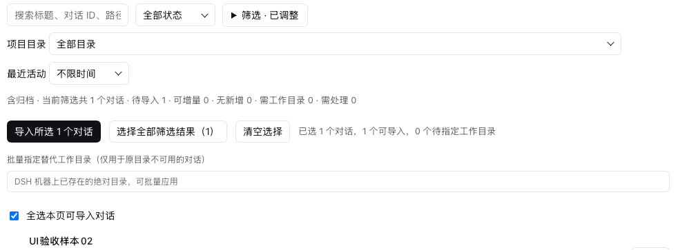

# Codex 对话迁移到 DSH

把本机 Codex 对话导入 DeepSeek Harness（DSH），在 DSH 里查看原有消息和工具记录，并接着聊。导入只读取 Codex 源文件，整个导入过程不调用模型。

## 安装

已验证的宿主版本为 DSH `0.2.2-rc.1`，插件需要 Node.js 22.15 或更高版本。

1. 在本仓库根目录运行以下命令，取得可安装的插件包。已有 `.tgz` 包可直接从第 2 步开始。

   ```sh
   npm ci
   npm pack
   ```

2. 打开 DSH 的「插件 → 添加插件」，选择刚生成的 `dsh-codex-migration-<版本>.tgz` 并启用。使用命令行时，可运行 `dsh plugin --profile web add ./dsh-codex-migration-0.4.1-beta.5.tgz`，文件名以本次打包输出为准。
3. 打开 DSH Web，在侧边栏找到「Codex 迁移」。首次启动可运行 `dsh web`。已运行的实例按宿主提示重新加载插件或重启；平时使用 `dsh-start` 管理的实例可用 `dsh-restart`。

## 第一次导入一个对话

1. 打开「Codex 迁移 → 对话列表」。插件读取 **DSH 所在机器**的 `CODEX_HOME`，默认是 `~/.codex`。如果历史在别处，填写该机器上的绝对路径，点击「刷新预览」。
2. 搜索一个熟悉的标题，点击「详情」核对消息摘录。等预览校验完成，勾选这一条「待导入」对话。列表默认没有选中项，按钮上的数量就是本次提交范围。
3. 点击「导入所选 1 个对话」，到「任务记录」查看结果。成功后点击「打开对话」，核对最后几条消息。
4. 像平常一样发送一条消息，例如「我们上次决定了什么？」。插件准备好上下文后会自动回答刚才的问题。



普通历史和归档历史都支持 `.jsonl` 与 `.jsonl.zst`。要找 Codex 已归档的对话，在「筛选」中勾选「已归档」。需要批量导入时，可选本页，也可点「选择全部筛选结果」跨页选择。

## 迁完以后怎么用

**原来的工具调用和结果仍可在历史中查看。** 首次续聊时，插件保留用户输入和助手正文的顺序，从发给模型的上下文中省略全部旧工具调用与结果。这样，模型可以使用 DSH 当前提供的工具；重启后旧工具轨迹也不会重新带入。首次续聊成功后，后续对话和自动压缩由 DSH 接管。

历史中可读的推理摘要、压缩摘要和本地可读取且受支持的附件也会随同导入。无法恢复的加密内容或附件会列入迁移报告。若对话使用了 subagent，其可用历史会随对话导入，可从该对话内打开。新导入的助手回复会省略末尾的 Codex 记忆引用标记。

**长对话放不下时**，页面会给出三个选择。想保留更多原文，可以切换到已配置的更大窗口模型；接受概括较早历史，可以选择「摘要后续聊」，当前问题保留原文；选择「取消」会保留已提交的问题、附件和已完成的摘要进度。原始导入日志始终可以查看。

## 重复导入、归档与撤回

| 现在的情况 | 再次导入会怎样 |
| --- | --- |
| 只有 Codex 增加了历史 | 向原 DSH 对话追加新内容，包括新增的 subagent。 |
| 两边都无新增，或只有 DSH 续聊了 | 跳过，保留 DSH 中已有的内容。 |
| 两边都续聊了，或已导入的 Codex 历史被改写、截断 | 报告冲突，保留当前历史。重启无法解决两边都续写的冲突。 |
| 对话已在 DSH 归档 | 归档保留原对话，再次导入仍按上述规则判断。要打开它，先在 DSH 侧栏取消归档。 |

**撤回导入（实验性）会永久删除所选的完整 DSH 对话。** 可在对话详情按条撤回，也可从已结束的任务记录或「撤回导入」页批量选择。确认前核对删除数量；所选对话有 DSH 续聊时，还须确认这些内容将永久丢失。即使只追加过一段历史，撤回也会删除整个对话。此操作不创建备份，之后可从 Codex 重新导入仍在源文件中的历史。

撤回支持 macOS/Linux 上具备进程替换能力的 Node.js，使用标准 `dsh web` 或 `dsh --profile web` 启动。确认后 **DSH Web 会短暂关闭**，插件离线复核所选内容，若内容已变化则取消删除，随后按原启动参数重启。

## 常见问题与命令参考

**显示「需工作目录」怎么办？** 在详情中填写 DSH 机器上已存在的目录，也可批量填写替代目录。只想先迁其他对话时，使用「仅导入可执行的」按钮。

**关掉页面或中途重启了怎么办？** 关闭页面或断网后，后台任务会继续。DSH 退出后，到「任务记录」打开中断的任务，点「继续此任务」。每个数据目录同时执行一个导入任务。主动结束任务会保留已写入的会话。

**部分对话失败，需要重扫全库吗？** 在原任务点「重新预览失败项」。插件重新发现源文件和对话归属，只深入校验失败或未完成的对话。检查新范围后再点导入；点「返回全部对话」可复用已有的完整预览。任务记录也可复制或下载诊断，诊断不含消息正文或附件。

**预览后又在 Codex 聊了一轮，能导进来吗？** 本次只导入预览已确认的历史。之后追加的内容，以及预览时尚未写完的轮次，可在下一次刷新后增量导入。若目标提示被 DSH 占用，先保存工作，再重启 DSH 后重试。

**「生效窗口」很大，为什么还提示超限？** 生效窗口是本次模型请求的总容量。「输入估算」是准备发送的上下文大小，「预算」是考虑输出预留、当前 DSH 自动压缩配置和估算余量后可用于输入的额度。展开「首次续聊准备」比较**输入估算与预算**；前者超过后者时，可选择更大窗口或摘要后续聊。

<details>
<summary>在已有 DSH 对话中使用斜杠命令</summary>

从输入框左侧的指令菜单选择命令。预览完成后，点击命令卡片查看报告。

| 导入命令 | 用途 |
| --- | --- |
| `/import-codex` | 预览普通对话 |
| `/import-codex --archived` | 预览时纳入归档 |
| `/import-codex <id1> <id2>` | 预览指定对话 |
| `/import-codex <id1> <id2> --execute` | 导入指定对话 |
| `/import-codex --all --execute` | 导入当前范围内全部对话 |
| `/import-codex <id> --archived --execute --cwd "/现有目录"` | 原工作目录不可用时使用指定目录 |

| 续聊命令 | 用途 |
| --- | --- |
| `/codex-context status` | 查看当前选择 ID 和状态 |
| `/codex-context models <选择ID>` | 刷新更大窗口模型列表 |
| `/codex-context model <选择ID> <模型序号>` | 切换模型，序号从 0 开始 |
| `/codex-context summarize <选择ID>` | 开始或恢复摘要，完成后续聊 |
| `/codex-context summaries <选择ID>` | 查看已保存的摘要与来源 |
| `/codex-context cancel <选择ID>` | 取消本次准备 |

</details>

开发、测试与提交约定见[贡献指南](AGENTS.md)。

## 许可证

本项目采用 [MIT 许可证](LICENSE)。
